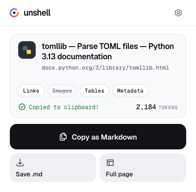
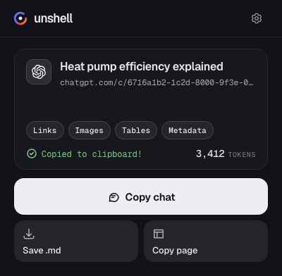

<p align="center">
  
</p>

<h1 align="center">Unshell</h1>

<p align="center">
  <strong>Browser extension that turns web pages and chats into clean Markdown for LLMs</strong>
</p>

<p align="center">
  <a href="LICENSE"></a>
  <a href="https://github.com/dekrezz/Unshell/releases"></a>
  
  
</p>

<p align="center">
  <a href="#start-here">Start here</a> •
  <a href="#quick-start">Quick start</a> •
  <a href="#what-you-get">What you get</a> •
  <a href="#site-aware-extraction">Sites</a> •
  <a href="#shortcuts">Shortcuts</a> •
  <a href="#settings">Settings</a> •
  <a href="#privacy-and-permissions">Privacy</a> •
  <a href="#build">Build</a>
</p>

<p align="center">
  
  
</p>

## Start here

**What it is.** Unshell turns whatever is on your screen into Markdown you can paste into ChatGPT, Claude, Gemini or any other LLM. One click copies a page, one copies a highlighted fragment, one copies a whole chat transcript. It runs in Chrome and Firefox.

**What stays private.** Conversion happens in your browser. There is no account, no telemetry, and page content is never sent anywhere. What does touch the network is listed under [Privacy and permissions](#privacy-and-permissions): the optional token counter, the page card's icon, and the extractors that read a site's own API instead of its rendered page.

**You need:** Chrome or Firefox, plus Git, `bash` and `zip` to build the package from source. Packaged builds are also attached to [Releases](https://github.com/dekrezz/Unshell/releases).

### 1. Build it (one minute)

```bash
git clone https://github.com/dekrezz/Unshell.git
cd Unshell
bash scripts/build.sh all          # or: make chrome / make firefox
```

Packages land in `dist/`.

### 2. Load it

| Browser | Steps |
|---|---|
| Chrome | `chrome://extensions` → Developer mode → Load unpacked → the extracted `dist/Unshell-Chrome-*.zip` |
| Firefox | `about:debugging#/runtime/this-firefox` → Load Temporary Add-on → `manifest.json` from the extracted Firefox package |

Release Firefox only installs signed add-ons permanently. For a permanent unsigned install use Developer Edition, Nightly or ESR with `xpinstall.signatures.required=false`.

### 3. Copy something

Open any page and press `Alt+Shift+M`, or click the toolbar button and pick an action. Paste into your model. Everything else is below.

---

## Contents

- [Start here](#start-here)
- [What you get](#what-you-get)
- [Features](#features)
- [Quick start](#quick-start)
- [Site-aware extraction](#site-aware-extraction)
- [Shortcuts](#shortcuts)
- [Settings](#settings)
- [Privacy and permissions](#privacy-and-permissions)
- [Project layout](#project-layout)
- [Build](#build)
- [Credits](#credits)
- [License](#license)

---

## What you get

| Action | What you get |
|--------|--------------|
| **Convert & Copy** | The page as Markdown: article body by default, full page on demand |
| **Copy Selection** | Only what you highlighted, prefixed with the line range and source. Code is detected and fenced with its language; prose keeps its links and lists |
| **Copy Chat** | An LLM conversation with roles and timestamps: the whole thread or just the last N exchanges |
| **Download Markdown** | The same output as a `.md` file |
| **Multi-tab** | Several selected tabs at once, merged into one file or zipped separately |

## Features

- **Chrome and Firefox:** one source tree, a Manifest V3 build for each browser
- **Local conversion:** Readability and Turndown run in your browser
- **Site-aware extractors:** Reddit, X, GitHub, GitHub Discussions, YouTube, Discord, Telegram and LLM chat front-ends
- **Token counter:** optional
- **Keyboard shortcuts:** four defaults, rebindable
- **No silent fallbacks:** when an extraction path fails, you get a specific message
- **License:** MIT

---

## Quick start

```bash
git clone https://github.com/dekrezz/Unshell.git
cd Unshell
bash scripts/build.sh all
```

`build.sh` takes one of `chrome`, `firefox`, `source` or `all`, and an optional version:

```bash
bash scripts/build.sh chrome | firefox | source | all
bash scripts/build.sh --version 2.3.0 all
```

The output files are `dist/Unshell-Chrome-v<version>.zip`, `dist/Unshell-Firefox-v<version>.zip` and `dist/Unshell-Source-v<version>.zip`. `make chrome`, `make firefox`, `make source` and `make all` call the same script. Load the result as shown in [Start here](#start-here).

---

## Site-aware extraction

- **Reddit:** the post plus its full comment tree (author, score, flair), read from Reddit's own JSON so collapsed replies survive. Replies are addressed by position in the tree (`[1]`, `[1.1]`, `[1.1.1]`) rather than by indentation. Deleted comments are dropped and their surviving replies move up into the slot. Reddit's own promoted posts and comment-tree ads are removed on every path, including full-page copies.
- **X (Twitter):** threads with replies, quoted posts and engagement counts; profiles and timelines as an index.
- **GitHub Discussions:** the post and its whole reply thread, with authors, timestamps, role badges and reactions, read from the page because discussions exist only in GitHub's GraphQL API. Replies are addressed by position, and each field is read from the comment it belongs to, because GitHub nests a reply inside the comment it answers.
- **GitHub:** a repository page as the name, description and facts, then the README **as its original Markdown** and the complete recursive file tree. Both come from GitHub's API rather than the page. This costs three of the 60 requests an hour GitHub grants a signed-out caller, and says so by name when they run out.
- **YouTube:** a video as its title, channel and facts, the description **in full** (the page clamps it to two lines), and the comment thread with likes, dates and replies. Comments are read from the same endpoint the page uses, a page at a time up to your ceiling.
- **Discord:** the open channel as a transcript: authors, timestamps, reply context and attachment links, with the virtualised list scrolled upward for history. It is read from the rendered page on purpose: Discord's API needs your account token, which Discord treats as self-botting and bans for.
- **Telegram:** the open conversation on `web.telegram.org` as a transcript. Channels, groups, forum topics, private chats and bots are told apart and rendered as what they are; a bot keeps its button menus. Message bodies go through Turndown, so a linked word stays a link. Telegram's own sponsored posts are dropped. On a Telegram page the popup replaces Convert & Copy with one button naming the target (for example "Copy Жалобы topic"), with a ceiling on the last N messages and an optional date range.
- **Chats:** ChatGPT, Claude, Gemini, Google AI Mode, Grok, Perplexity, DeepSeek, Copilot, Cursor, and self-hosted front-ends on a local port (Open WebUI, LibreChat, LobeChat, AnythingLLM, Jan). On ChatGPT and Claude the transcript comes from the site's own API and follows the branch you actually see, so messages you edited away stay out.

---

## Shortcuts

| Action | Default |
|--------|---------|
| Open Unshell | `Alt+Shift+L` |
| Convert & copy | `Alt+Shift+M` |
| Download Markdown | `Alt+Shift+D` |
| Download tabs as ZIP | `Alt+Shift+Z` |

Rebind them at `chrome://extensions/shortcuts` or in Firefox's add-on manager.

---

## Settings

- **Content scope:** main article, full page, or selection
- **Formatting:** tables, images, links, page title, metadata template
- **Reddit:** comment sort and a cap on comments per thread
- **X:** replies on or off and a cap on posts
- **Chats:** what a chat copy takes: the last 3 days by default, by the dates ChatGPT and Claude give their messages; or the last N exchanges; or the whole chat. A chat without dates is cut by the exchange count, and the copy says so. The range picker on the page card is off until you turn it on
- **Token counter**, **debug logging**, **lazy-load auto-scroll**

---

## Privacy and permissions

Page content is never sent anywhere. The network is touched in these cases only:

- **Token counter (optional):** fetches static tokenizer data from `tiktoken.pages.dev` once and caches it.
- **The page card's icon:** Chrome serves it from its own favicon cache (the `favicon` permission), with no request. Firefox has no such cache for extensions, so the popup shows the icon address Firefox reports for the tab, which can be a request to the site you are on.
- **Site-specific extractors:** on Reddit, GitHub and YouTube, and for ChatGPT and Claude transcripts, the extractor calls the site's own endpoints instead of reading the rendered page, as described under [Site-aware extraction](#site-aware-extraction).

Declared in `extension/manifest.json`:

| Kind | Entries |
|---|---|
| Permissions | `activeTab`, `tabs`, `clipboardWrite`, `storage`, `favicon` (Chrome only), `scripting`, `contextMenus`, `menus` |
| Hosts | `https://tiktoken.pages.dev/*` |
| Firefox data collection | None (`required: ["none"]`) |

The build drops the Chrome-only `favicon` permission from the Firefox package. Notes for add-on reviewers, including the status of the bundled libraries, are in [REVIEWERS.md](REVIEWERS.md).

---

## Project layout

```
extension/
├── manifest.json        Extension manifest (MV3; the build rewrites it for Firefox)
├── popup.html/js        Popup UI and settings
├── settings.js          Shared setting defaults, used by popup and background
├── styles.css           Popup styles
├── assets/              Popup fonts (Geist, Geist Mono, OFL licence) and the particle halo
├── motion.js            Springs, gestures, momentum, press feedback
├── content.js           Live-page extraction: selection, chat, lazy-load scroll
├── convert-core.js      Document to Markdown, used by the content script
├── selection.js         Highlighted-fragment excerpts (code vs prose, line range)
├── chat.js              LLM conversation export (site API + DOM fallback)
├── reddit.js            Reddit threads and listings
├── github.js            GitHub repositories and Discussions
├── discord.js           Discord channels
├── telegram.js          Telegram conversations
├── youtube.js           YouTube videos and comments
├── x.js                 X threads, profiles and timelines
├── multi-tab-utils.js   Multi-tab batching, worker pool, filenames, ZIP naming
├── token-counter.js     Token estimation
├── background.js        Keyboard shortcuts, context menus, multi-tab work
├── icons/               Extension icons (16, 48, 128, 1024)
└── libs/                Readability, Turndown, JSZip, browser-polyfill
```

Contributor and agent rules, architecture and the checks to run are in [AGENTS.md](AGENTS.md).

---

## Build

```bash
bash scripts/build.sh chrome | firefox | source | all
bash scripts/build.sh --version 2.3.0 all
```

Packages land in `dist/`. The Firefox build only copies files and rewrites two manifest keys (`background.scripts` instead of a service worker, and no `favicon` permission). The release workflow builds all three packages and attaches them to a GitHub release when one is created.

---

## Credits

- [Mozilla Readability](https://github.com/mozilla/readability) (Apache-2.0), [Turndown](https://github.com/mixmark-io/turndown) (MIT, with local edits disclosed in [REVIEWERS.md](REVIEWERS.md)), [JSZip](https://github.com/Stuk/jszip) (MIT / GPLv3) and [webextension-polyfill](https://github.com/mozilla/webextension-polyfill) (MPL-2.0), bundled in `extension/libs/`.
- [Geist and Geist Mono](https://github.com/vercel/geist-font) by Vercel, in collaboration with basement.studio (SIL OFL 1.1), bundled in `extension/assets/fonts/` with their licence.

## License

MIT. See [LICENSE](LICENSE).
